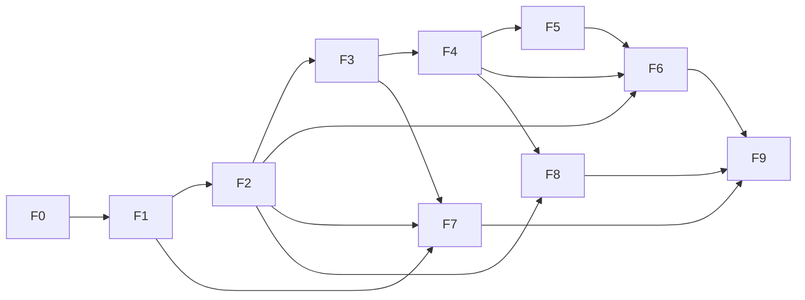

# Work Plan

This document shows how the assignment requirements were broken down into features and tasks,
the order of execution, dependencies and effort estimates.

Requirement references (`R1`–`R11`) follow the numbered sections of the assignment:

| Ref | Requirement |
|---|---|
| R0 | Data model and 100,000 repeatable test records |
| R1 | Data retrieval: pagination, filtering, search, sorting, aggregations, validation |
| R2 | Status update and optimistic concurrency |
| R3 | Status change history (audit) |
| R4 | Bulk status update |
| R5 | Angular client |
| R6 | Performance |
| R7 | Cache |
| R8 | Automated tests |
| R9 | Work planning |
| R10 | Code quality |
| R11 | Documentation |

Estimates are in hours and include implementation and self-review of each task.

## Progress

| Feature | Status | Notes |
|---|---|---|
| F0 | Done | Repository, solution, `global.json`, README skeleton, this plan |
| F1 | Done | Acceptance results below |
| F2 | Done (pending review) | API implemented; 25/25 manual checks; 48/48 automated tests. Test tasks T6.1–T6.2 were done here, alongside the API |
| F3–F9 | Not started | |

### F2 results

| Check | Result |
|---|---|
| Manual checks against 100,000 records | 25/25 passed; result counts matched direct MongoDB counts |
| Automated tests (`dotnet test`) | 48/48 passed in two consecutive runs (unit + integration against MongoDB, including the real 503 path) |
| Test database cleanup | The test database was dropped after each run; no other database changed |
| Defects found by the tests and fixed | `[Produces("application/json")]` overrode the `application/problem+json` content type of 400/404 responses; 500/503 responses had no `traceId` |

### F1 acceptance results

| # | Check | Result |
|---|---|---|
| A1 | Solution build | Passed: 0 errors, 0 warnings |
| A2 | No `DropDatabase` call in the code | Passed: 0 matches |
| A3 | Seeder rejects a wrong database name, a non-local host, and SRV / replica set / load-balanced connection strings | Passed: all exit with an unhandled exception before any MongoDB call; no database created |
| A4 | Seed 100,000 requests | Passed: 100,000 documents in 5.6–15.2 s across six runs, including index creation; the slower runs coincided with high memory pressure on the machine |
| A5 | Consistency rules I1–I6 | Passed: 0 violations across 100,000 documents |
| A6 | Non-uniform distribution | Passed: status Completed 35,036 / InProgress 30,134 / New 19,897 / Waiting 14,933; priority Low 40,169 / Medium 39,746 / High 20,085 |
| A7 | Indexes | Passed: `_id` plus the 7 planned indexes; 19.37 MiB in total (2.45–2.57 MiB per B-tree index, 4.36 MiB for the text index). The collection's storage size was not yet reported correctly after the bulk load and will be re-measured in F7 |
| A8 | Repeatability | Passed: identical counts, distributions and checksums (sum of `createdAt`, `updatedAt`, `version`) across two runs |
| A9 | Normal startup, twice | Passed: indexes ensured idempotently; Swagger returned HTTP 200 on both runs |
| A10 | Other databases untouched | Passed: user databases unchanged in size and document count. MongoDB's internal `config.system.sessions` changed, which is expected server behavior when a client connects |

---

## F0 — Planning and setup

| ID | Task | Deliverable | Depends on | Est. | Req |
|---|---|---|---|---|---|
| T0.1 | Analyze requirements; record open points and assumptions (status transitions, `ChangedBy` source, search semantics) | Assumptions section in README | — | 1 | R9, R11 |
| T0.2 | Verify development environment (.NET SDK, Node, Angular CLI, MongoDB mode) | Environment notes; decision: standalone MongoDB | — | 0.5 | R11 |
| T0.3 | Repository setup: Git, `.gitignore`, solution, `global.json`, README skeleton | Buildable solution under source control | — | 0.5 | R10, R11 |
| T0.4 | Work plan | This document | T0.1 | 2 | R9 |

## F1 — Data layer

| ID | Task | Deliverable | Depends on | Est. | Req |
|---|---|---|---|---|---|
| T1.1 | Design the request document: fields, enum storage (priority as number for correct ordering), `version`, embedded status history | Document classes; model section in README | T0.1 | 1.5 | R0, R2, R3 |
| T1.2 | MongoDB configuration: options, singleton client, DI registration | Configurable connection, no secrets in source | T1.1 | 1 | R10 |
| T1.3 | Define indexes and create them at startup | Index initializer; index table in README | T1.1, T1.2 | 1.5 | R1, R6 |
| T1.4 | Test data seeder: 100,000 records, fixed random seed, batched inserts, drop-and-recreate | Repeatable seeding command | T1.2, T1.5 | 2 | R0 |
| T1.5 | Allowed status transitions (moved from F4: the seeder generates history that must follow the same policy) | `StatusTransitions` policy | T1.1 | 1 | R2 |

## F2 — Query API

| ID | Task | Deliverable | Depends on | Est. | Req |
|---|---|---|---|---|---|
| T2.1 | Query parameters DTO and validation: page size limit, sort field whitelist, date range | Validated query model; 400 on invalid input | T1.1 | 2 | R1 |
| T2.2 | Repository query: combined filters, text search, sorting, skip/limit, projection, total count — all executed in the database | Server-side paged query | T1.3, T2.1 | 3 | R1, R6 |
| T2.3 | Endpoints: list requests, get request by id; response DTOs and mapping | `GET /api/requests`, `GET /api/requests/{id}` | T2.2 | 1 | R1 |
| T2.4 | Global error handling with ProblemDetails; logging at meaningful points | Consistent error responses | T0.3 | 1.5 | R10 |

## F3 — Summary and cache

| ID | Task | Deliverable | Depends on | Est. | Req |
|---|---|---|---|---|---|
| T3.1 | Aggregations: counts by status and by priority, computed in the database | `GET /api/requests/summary` | T1.3 | 1.5 | R1 |
| T3.2 | Cache the summary with absolute expiration; invalidate after status changes | Cached summary; cache section in README | T3.1 | 1.5 | R7 |

## F4 — Status update, concurrency and history

| ID | Task | Deliverable | Depends on | Est. | Req |
|---|---|---|---|---|---|
| T4.2 | Conditional atomic update: status, `updatedAt`, `version` increment and history entry in one operation; 404 / 409 / validation errors | `PATCH /api/requests/{id}/status` | T1.5, T2.4 | 3 | R2, R3 |
| T4.3 | History endpoint | `GET /api/requests/{id}/history` | T4.2 | 1 | R3 |

## F5 — Bulk update

| ID | Task | Deliverable | Depends on | Est. | Req |
|---|---|---|---|---|---|
| T5.1 | Bulk status update (up to 100 items), partial success with a per-item result | `POST /api/requests/status/bulk`; policy documented | T4.2, T3.2 | 3 | R4 |

## F6 — Automated tests

| ID | Task | Deliverable | Depends on | Est. | Req |
|---|---|---|---|---|---|
| T6.1 | Test project; integration fixture with `WebApplicationFactory` and an isolated database per run | Test infrastructure | T2.3 | 2 | R8 |
| T6.2 | Query tests: valid filtering/sorting/paging; invalid parameters | Passing tests | T6.1 | 2 | R8 |
| T6.3 | Update tests: concurrent update conflict, not found, invalid transition | Passing tests | T6.1, T4.2 | 2 | R8 |
| T6.4 | Bulk and cache invalidation tests | Passing tests | T6.1, T5.1 | 1.5 | R8 |

## F7 — Performance

| ID | Task | Deliverable | Depends on | Est. | Req |
|---|---|---|---|---|---|
| T7.1 | Measure two key operations (filtered list, summary) on 100,000 records using `explain("executionStats")`, before and after indexes | `docs/performance.md` with measurements | T1.4, T2.2, T3.1 | 2 | R6 |
| T7.2 | Identify a bottleneck and propose an improvement | Section in `docs/performance.md` | T7.1 | 1 | R6 |

## F8 — Angular client

| ID | Task | Deliverable | Depends on | Est. | Req |
|---|---|---|---|---|---|
| T8.1 | Create the Angular project; API base URL configuration; CORS on the API | Running client shell | T2.3 | 1.5 | R5 |
| T8.2 | API service and client models | `RequestsApiService` | T8.1 | 1.5 | R5 |
| T8.3 | Requests list: filters, debounced search, request cancellation (`switchMap`), sorting, paging, loading/empty/error states | List page | T8.2 | 5 | R5 |
| T8.4 | Summary panel | Aggregations view | T8.2, T3.1 | 1 | R5 |
| T8.5 | Status update with 409 conflict handling | Update flow | T8.3, T4.2 | 2.5 | R5 |
| T8.6 | Status history view | History view | T8.3, T4.3 | 1.5 | R5 |
| T8.7 | Client tests for the API service (optional) | Passing tests | T8.2 | 1.5 | R8 |

## F9 — Documentation and submission

| ID | Task | Deliverable | Depends on | Est. | Req |
|---|---|---|---|---|---|
| T9.1 | Complete README: run instructions, structure, indexes, concurrency, bulk, cache, decisions, limitations | Final README | All features | 3 | R11 |
| T9.2 | AI usage section | README section | T9.1 | 0.5 | R11 |
| T9.3 | Clean-run verification from a fresh clone | Verified instructions | T9.1 | 1 | R11 |
| T9.4 | Publish the repository | Accessible repository link | T9.3 | 0.5 | Submission |

---

## Execution order

1. **F0** — planning and setup
2. **F1** — data layer (model, indexes, seeder)
3. **F2** — query API and global error handling
4. **F3** — summary and cache
5. **F4** — status update, concurrency and history
6. **F5** — bulk update
7. **F6** — tests (written alongside F2–F5, completed here)
8. **F7** — performance measurements
9. **F8** — Angular client
10. **F9** — documentation and submission

## Effort summary

| Feature | Est. (h) |
|---|---|
| F0 Planning and setup | 4 |
| F1 Data layer | 7 |
| F2 Query API | 7.5 |
| F3 Summary and cache | 3 |
| F4 Status update and history | 4 |
| F5 Bulk update | 3 |
| F6 Automated tests | 7.5 |
| F7 Performance | 3 |
| F8 Angular client | 14.5 |
| F9 Documentation and submission | 5 |
| **Total** | **58.5** |
